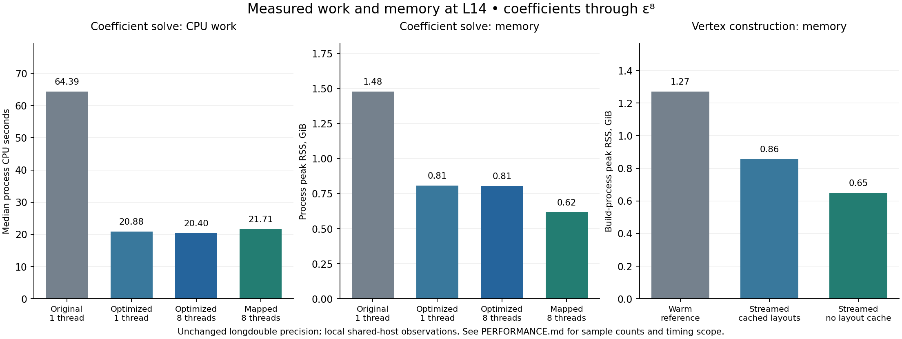

# Performance measurements and scaling limits

Generated by `benchmarks/summarize_results.py` from the saved JSON measurements. The machine-readable companion is `results/performance_summary.json`, which records every input file and its SHA-256. Regeneration performs no numerical solve or benchmark.

At **L = 14, through order epsilon^8**, the final one-thread solver used **20.88 CPU seconds versus 64.39** for the original: a **3.08× reduction in CPU work**. The final eight-thread configuration had an observed median wall time of **22.89 s**. With the mapped vertex store, the observed process peak was **633.0 MiB**, compared with **1515.8 MiB** for the original.

These are local observations from a shared execution environment. The CPU-work reduction is more consistent than the wall timings. The data do not establish dedicated-node speedup, strong scaling across nodes, or a DRAM-bandwidth limit.



## 1. Main coefficient-solver measurements

All rows use the self-consistent scalar vacuum window, order eight, 4,486 scalar bath states, and 10 local states per field parity. Working arithmetic has 64 binary significand bits in a 16-byte `longdouble` slot on this host. The SO(3) projectors retain their original binary64 source precision.

| Configuration | Input storage | Ranks × requested threads | Repeats | Median wall s | Median CPU s | Process peak MiB | Source |
|---|---|---:|---:|---:|---:|---:|---|
| Original, 1 thread | legacy in-memory arrays | 1 × 1 | 1 | 79.85 | 64.39 | 1515.8 | [reference_L14_stationary_t1.json](../benchmarks/reference_L14_stationary_t1.json) |
| Optimized, 1 thread | legacy in-memory arrays | 1 × 1 | 2 | 47.12 | 20.88 | 828.3 | [final_optimized_L14_t1_pickle.json](../benchmarks/final_optimized_L14_t1_pickle.json) |
| Optimized, 8 threads | legacy in-memory arrays | 1 × 8 | 3 | 22.89 | 20.40 | 825.4 | [final_optimized_L14_t8_pickle.json](../benchmarks/final_optimized_L14_t8_pickle.json) |
| Optimized mmap, 8 threads | verified read-only mmap | 1 × 8 | 1 | 25.62 | 21.71 | 633.0 | [final_optimized_L14_t8_store.json](../benchmarks/final_optimized_L14_t8_store.json) |

Wall and CPU times cover the coefficient solve after input loading. Compilation, input loading/checksums, and subsequent result validation are outside that timed region. CPU seconds are the process user-plus-system CPU-time difference measured with `getrusage`. Peak RSS is the process high-water mark and includes input loading; it is not an incremental allocation count. The mmap run has one sample.

The original reference had 79.85 s wall time. The observed ratio against the optimized eight-thread median is 3.49×. This combines algorithmic changes, native execution, threading, and host scheduling; it is not an eight-thread scaling factor. In particular, one-thread optimized CPU time was 20.88 s while its wall time was 47.12 s. The measurements do not separate the causes of that waiting time.

The reference benchmark filename contains `stationary` because that was the benchmark parser default. The unmodified reference function ignores that option and executes its original full recurrence. No profiled reference run is used as the headline speed baseline.

### Repeat-level observations

| Configuration | Wall samples s | CPU samples s |
|---|---|---|
| Original, 1 thread | 79.85 | 64.39 |
| Optimized, 1 thread | 46.97, 47.26 | 21.87, 19.89 |
| Optimized, 8 threads | 23.66, 22.77, 22.89 | 21.15, 20.40, 20.11 |
| Optimized mmap, 8 threads | 25.62 | 21.71 |

### CPU work at three cutoffs

| Requested cutoff | Loaded vertex cutoff: original / optimized | Original CPU s | Optimized CPU s | CPU ratio | Sources |
|---:|---:|---:|---:|---:|---|
| 8 | 8 / 8 | 0.656 | 0.212 | 3.09× | [final_reference_L8_t1_pickle.json](../benchmarks/final_reference_L8_t1_pickle.json); [final_optimized_L8_t1_pickle.json](../benchmarks/final_optimized_L8_t1_pickle.json) |
| 12 | 14 / 14 | 10.797 | 3.600 | 3.00× | [reference_L12_stationary_t1.json](../benchmarks/reference_L12_stationary_t1.json); [final_optimized_L12_t1_pickle.json](../benchmarks/final_optimized_L12_t1_pickle.json) |
| 14 | 14 / 14 | 64.386 | 20.881 | 3.08× | [reference_L14_stationary_t1.json](../benchmarks/reference_L14_stationary_t1.json); [final_optimized_L14_t1_pickle.json](../benchmarks/final_optimized_L14_t1_pickle.json) |

These are comparisons of the same requested finite problem at each cutoff. Some runs load a larger vertex cache before selecting a smaller cutoff; their peak RSS therefore should not be fitted as an intrinsic memory-scaling law.

## 2. Where the work went, and why the changes target it

The initial L14 reference profile spent 132.13 s of 169.28 s in 3,388 CSR multivector applications. The provisional-energy path alone accounted for 78.23 s, because it formed full vectors and retained only their seed component. The profile identified the main target before implementation changes. [baseline_solve_L14_profile.json](../benchmarks/baseline_solve_L14_profile.json)

The optimized solver contracts seed rows/columns directly, constructs wavefunctions only through order four for the stationary energy calculation, reuses cutoff/parity metadata, and releases combined Hamiltonians after use. The original finite basis, coupling tuning, and every window contribution through the requested energy order are preserved. `docs/NUMERICS.md` supplies the formal-series proof.

An intermediate optimized profile reduced full CSR applications to 1,056. At that stage, the native sparse interface occupied 11.83 s (60.3% of its profiled wall time), local dense oscillator work appeared in 3.81 s of `apply` self time, and Hamiltonian combinations took 3.14 s. This motivated the final banded local operations and the conservative tiny-product serial dispatch. This intermediate profile is a bottleneck diagnostic, not a final performance sample. [optimized_L14_stationary_t8_profile.json](../benchmarks/optimized_L14_stationary_t8_profile.json)

## 3. Vertex construction: memory choices matter more than the modest time change

The following controlled build comparisons have warm JIT caches and profiling enabled. The initial cold run is deliberately excluded from speed ratios. All produce the same L14 Taylor vertices through degree six.

| Builder configuration | Wall s | Build-process peak MiB | Source |
|---|---:|---:|---|
| Warm reference | 100.27 | 1302.2 | [baseline_build_L14_warm_profile.json](../benchmarks/baseline_build_L14_warm_profile.json) |
| Streamed, cached layouts (default) | 92.76 | 878.3 | [optimized_build_L14_cached_stream_profile.json](../benchmarks/optimized_build_L14_cached_stream_profile.json) |
| Streamed, no layout cache | 109.01 | 664.4 | [optimized_build_L14_stream_profile.json](../benchmarks/optimized_build_L14_stream_profile.json) |

The default streamed builder lowers the measured peak by 32.6%; disabling the layout cache lowers it by 49.0% relative to the warm reference. Disabling the cache repeats format conversions and costs time. The peak is captured before loading the reference arrays for comparison, so the validation copy is excluded.

The builder skips 1,484 structurally zero products and executes 2,912 required products. Annihilation images are streamed, and reusable CSR/CSC layouts avoid repeated conversion when memory permits. The shared-pattern .npy store holds 325.8 MiB of numerical arrays with 15 sparse patterns; the unshared logical vertex buffers total 357.5 MiB. File headers and manifest metadata are additional small storage costs.

## 4. Native threads: measured kernel behavior

For the largest tested L14 bath vertex, 1,733,150 nonzeros and 10 dense right-hand sides, passive OpenMP waiting gave these five-sample medians. The numerical outputs agreed exactly with the same-precision SciPy product.

| Backend | Requested threads | Median ms | Observed min–max ms |
|---|---:|---:|---:|
| scipy | 1 | 217.75 | 195.25–392.05 |
| native | 1 | 280.70 | 266.29–325.26 |
| native | 2 | 163.95 | 148.00–262.50 |
| native | 4 | 117.66 | 91.98–266.25 |
| native | 8 | 67.95 | 65.63–80.09 |

Source: [native_kernel_benchmark_passive.json](../results/native_kernel_benchmark_passive.json). The operation timed is the backend CSR-apply interface with reusable output. SciPy creates a temporary product before copying to that output; the native kernel writes directly. The SciPy cropped matrix is prepared before timing and reused. These interface measurements are not the whole-solver result.

Idle OpenMP spinning caused large delays for small products in an initial run. The reported runs use `OMP_WAIT_POLICY=PASSIVE` and `GOMP_SPINCOUNT=0`. The final backend additionally runs products serially below a conservative 10,000 stored-prefix-nonzeros × RHS threshold. A 50,000 threshold was rejected because a measured 45,700-work case benefited from four threads. The threshold is configurable and zero disables it. Metadata records the requested and dispatched thread counts. Neither tuning changes arithmetic precision or the summation order within a row.

Nine CPUs were available in process affinity. CPU-model and quota files were not exposed. The timing data cannot establish whether arithmetic throughput, memory traffic, scheduler interference, or another host limit controls a particular thread count. Choose rank/thread layouts on the intended cluster using the supplied benchmark programs.

## 5. MPI: local validation and measured row distribution

The MPI path distributes sparse matrix rows and replicates wavefunctions, the small energy/window series, and the seed row. Each rank evaluates its complete Hamiltonian image in the original term order, followed by one gather of disjoint output rows. This avoids a floating-point reduction and reduces collective count compared with gathering every bath term. Tuning coefficients and vacuum energies are broadcast after each order.

These runs use multiple processes on the same host. They measure local execution and memory; they do not measure a cluster interconnect.

| Ranks × threads/rank | Input | Max-rank solve wall s | Max-rank peak MiB | Logical vertex MiB per rank | Max scaled coefficient/energy error | Source |
|---:|---|---:|---:|---|---:|---|
| 2 × 1 | mmap → owned CSR rows | 62.45 | 445.0 | 178.4, 179.7 | 2.4069288229178198435E-17 | [final_mpi_L14_r2_t1.json](../benchmarks/final_mpi_L14_r2_t1.json) |
| 4 × 1 | mmap → owned CSR rows | 89.60 | 276.0 | 90.6, 88.4, 88.5, 91.8 | 2.4069288229178198435E-17 | [final_mpi_L14_r4_t1.json](../benchmarks/final_mpi_L14_r4_t1.json) |

MPI solve time excludes loading and setup and uses the slowest rank. Peak RSS includes setup, hashing, and mapped pages. Logical vertex bytes count the sparse buffers, including repeated references to shared pattern arrays; they are not an RSS measurement. Rank-zero checksum verification can touch the whole mapped input before the owned-row copies are made. Replicated vectors and seed rows prevent total process memory from decreasing exactly as the reciprocal of rank count.

The local tests demonstrate the memory-capacity benefit: the maximum process peak drops from 445.0 to 276.0 MiB between 2 and 4 ranks. Observed wall time changes from 62.45 to 89.60 s. These local copy-transport runs do not demonstrate a parallel latency improvement.

### Local MPI transport caveat

The first large-message launch hit a sandbox restriction on `process_vm_readv`, used by the default cross-memory-attach transport. That launch was an infrastructure failure, not an application numerical failure. The completed validation/measurements use ordinary MPICH copy transport with these settings:

```bash
export MPIR_CVAR_CH4_NETMOD=ofi
export MPIR_CVAR_CH4_CMA_ENABLE=0
```

The change does not alter application arithmetic. These are settings for this test environment, not a recommendation to disable the cluster’s normal transport. The MPI environment and limitation are recorded in [mpi_test_environment.json](../benchmarks/mpi_test_environment.json).

## 6. What still grows at larger cutoffs

The optimized construction still builds the full bath annihilation graph on one process. Only the coefficient solver’s sparse matrices are distributed by the supplied MPI backend. The graph preflight counts exact graph buffers, not projectors, intermediate sparse products, vertices, wavefunctions, or total process peak memory.

| Cutoff | Full bath states | Graph edges | Graph arrays GiB only |
|---:|---:|---:|---:|
| 14 | 1,784,949 | 7,805,937 | 0.142 |
| 16 | 8,778,392 | 42,095,538 | 0.745 |
| 18 | 40,968,710 | 213,091,592 | 3.694 |
| 20 | 182,727,113 | 1,022,077,961 | 17.411 |
| 22 | 783,193,597 | 4,678,486,564 | 78.507 |
| 24 | 3,240,244,094 | 20,553,422,735 | 429.050 |

Source: [graph_preflight.json](../benchmarks/graph_preflight.json). These counts explain why a modest L14 process peak cannot be scaled linearly to L20 or beyond. The implementation reduces temporary storage and unnecessary work but does not remove the growth of the underlying finite Hilbert space. There is no measured L16/L18/L20 coefficient calculation in this performance campaign.

For a large campaign, build each verified vertex store once, stage it where the cluster can read it efficiently, and use independent scheduler jobs for cutoffs or window prescriptions when practical. Use MPI row distribution when matrix memory requires it, then benchmark a few ranks per node with threads assigned within each rank. More ranks eventually add replicated vectors and communication. `--no-layout-cache` supplies the lower-memory builder choice. Site-specific memory and thread choices should follow measured peak RSS and the graph preflight, not the graph count alone.

## 7. Numerical validation accompanying the timings

All final L14 solver samples in the main table agree with the saved original coefficients, couplings, seed energies, and subcutoff vacuum energies with maximum scaled discrepancy 2.4069288229178198435E-17. The frozen benchmark gate is 5e-13, substantially larger than the observed roundoff differences. The builder comparisons report zero value discrepancy for all 28 vertex matrices. This is preservation of the specified finite Hamiltonian and scalar vacuum-window correction, not a new continuum claim.

The native suite has 44 matrix fixtures plus dispatch-policy checks. The independent stationary toy suite has 20 cases through order twelve, with worst scaled discrepancy 3.8025300045182803164E-17. Physical checks target coefficients through order eight. See `docs/NUMERICS.md` and the individual validation JSON files for what each test establishes.

The final all-cutoff coefficient campaign is included in [final_coefficient_validation.json](../results/final_coefficient_validation.json), with extracted maximum scaled discrepancy 6.591949208711866959E-17.

## 8. Reproduce and regenerate

Use the existing store for coefficient benchmarks; timing a solve does not require rebuilding the vertices. For example, from the package directory:

```bash
export OPENBLAS_NUM_THREADS=1 OMP_NUM_THREADS=1 NUMBA_NUM_THREADS=1
export OMP_WAIT_POLICY=PASSIVE GOMP_SPINCOUNT=0
python benchmarks/benchmark_solver.py --store /path/to/vertices_L14 \
  --solver optimized --strategy stationary --local-mode banded \
  --backend native --threads 8 --cutoff 14 --repeats 3 \
  --output /path/to/new_solver_benchmark.json
python benchmarks/benchmark_native.py --store /path/to/vertices_L14 \
  --threads 1 2 4 8 --repeats 5 --serial-work-threshold 0 \
  --output /path/to/new_kernel_benchmark.json
python benchmarks/summarize_results.py --figure docs/performance.png
```

The optional `--figure` output requires Matplotlib (`python -m pip install matplotlib`). Omit that flag to regenerate only the Markdown and JSON using the Python standard library.

The report generator consumes the named saved experiment files; it does not automatically replace them with a new cluster’s results. Keep new benchmark outputs separate or deliberately update the named inputs and regenerate. The full repeated samples, configuration, precision metadata, and source hashes remain the audit trail.
